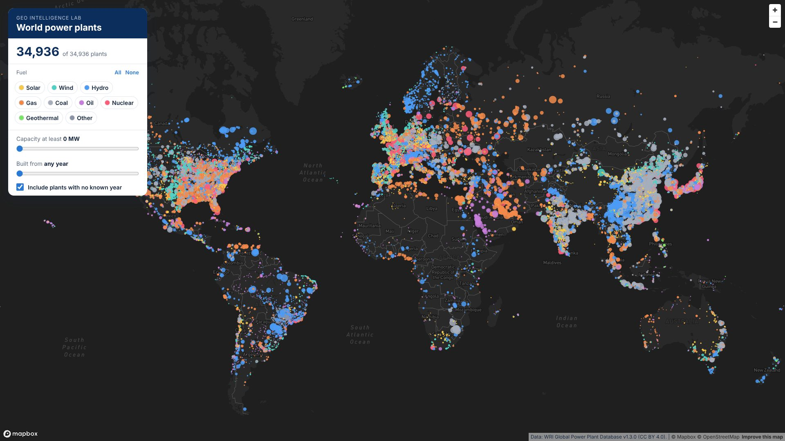

# Live Map Filters with Mapbox Expressions in React

Source code for the Geo Intelligence Lab video **"Filter Map Features Live with Mapbox Expressions in React"**.

A map of 34,936 power plants worldwide, with live filters for fuel, capacity and year, built with React, TypeScript, Vite and Mapbox GL JS.



## What's inside

| Folder | What it is |
|---|---|
| [`starter/`](starter) | The broken version, with three bugs. Fix it with the video |
| [`final/`](final) | The finished app shown in the video |

The finished app covers:

- **`setFilter` with an expression:** the data stays in the source, and only the rule goes to the map
- **`literal`:** a bare array in an expression means an operator, so lists must be wrapped
- **`case` for null:** check for a missing value before you compare it
- **Counting from the data:** `queryRenderedFeatures` only sees what's on screen
- **`match` and `interpolate`:** colour and size in the layer's paint

## Where each idea lives (`final/src`)

| File | What it teaches |
|---|---|
| `map/filters.ts` | `buildFilter` (the expression) and `matches` (the same rules for the count), side by side |
| `map/layers.ts` | The circle layer, with `match` and `interpolate` paint expressions |
| `hooks/useFilters.ts` | The filter state |
| `components/MapView.tsx` | Creates the map and calls `setFilter` |
| `components/FilterPanel.tsx` | The controls, in plain React |
| `App.tsx` | Loads the data and counts with `useMemo` |

## Run it

```bash
cd final              # or starter
npm install
cp .env.example .env  # put your public Mapbox token (pk.…) in .env
npm run dev
```

Then open http://localhost:5173.

## Data

[Global Power Plant Database v1.3.0](https://datasets.wri.org/dataset/globalpowerplantdatabase), World Resources Institute, CC BY 4.0. `npm run data` rebuilds `public/data/plants.geojson`. The database is no longer updated, so use it for learning, not for current figures.

## More

- Free GIS Developer Starter Kit: [geointelligencelab.com/toolkit](https://geointelligencelab.com/toolkit)
- YouTube: [@GeoIntelligenceLab](https://www.youtube.com/@GeoIntelligenceLab)
- Portfolio: [johnsaita.github.io](https://johnsaita.github.io)
